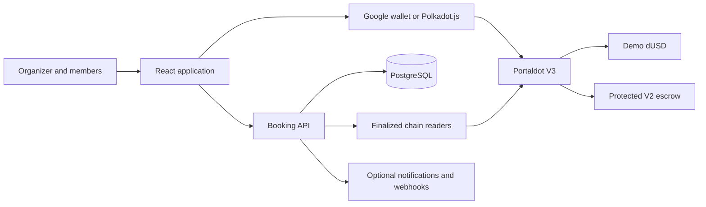

# PactPay

**One booking. Every share accounted for.**

PactPay helps groups agree on a shared booking, contribute individual fixed shares, and follow the money through collection, payout or refund. It serves workshops, classes, group activities and shared services where an organizer needs commitments from several people before proceeding.

The organizer sets the price and terms. Members join through invitations, review their shares and accept the same revision. The organizer locks the agreed booking and publishes it before payments open. The escrow records contributions, deadlines and the conditions for receiving or refunding funds.

**Try the application:** [Group bookings](https://pactpay-portaldot-2026.vercel.app/booking) · [Profile](https://pactpay-portaldot-2026.vercel.app/booking/profile) · [Native wallet workspace](https://pactpay-portaldot-2026.vercel.app/native)

**Network:** Portaldot V3 Testnet · **Payment asset:** demo dUSD · **Network fees:** tPOT

> This is a testnet application. Demo dUSD has no backing or monetary value. Hosting, contract deployment, finalized transactions and a complete user journey are separate milestones. The status below distinguishes them.

## The problem

A shared booking creates several separate commitments: who is joining, what each person owes, which terms they accepted, and what happens if the plan falls through. In a chat-and-transfer workflow, these details can be scattered across messages, spreadsheets and payment screenshots.

For an organizer, collecting money can mean checking each transfer, reminding people, tracking changes and working out who needs a refund. If some members pay and others drop out, the organizer must decide whether to cover the shortfall, cancel or renegotiate the booking.

For a member, sending a share does not by itself explain where the money is held, when the merchant can receive it, or how to recover it after cancellation. A payment screenshot also cannot establish that everyone agreed to the same price and terms.

There is another source of confusion when a payment is interrupted: an approval, a submitted transaction, a successful payment and an available refund are different states. Without a clear next step, a person may retry unnecessarily or assume money has arrived when it is still waiting to be claimed.

These are the workflow problems PactPay is designed to address. They are product hypotheses, not claims of measured market demand or proven savings from an independent user study.

## What PactPay solves

PactPay gives the group one booking record with explicit shares, agreement and payment rules. The organizer coordinates the plan; each member retains control of their own payment authorization.

| Problem | PactPay's response | Practical result |
| --- | --- | --- |
| People have different understandings of the price or terms | Members review fixed shares and accept a specific booking revision; material changes require fresh acceptance | A shared record of what the group agreed to before paying |
| The organizer has to match transfers to people | Each contribution is tied to a listed member and their exact share | The booking shows individual funding progress |
| Only part of the group pays | The merchant can capture only a fully funded V2 booking before its deadline | The contract does not let the merchant capture an underfunded collection |
| The booking is cancelled or misses its funding/capture conditions | Eligible paid positions can be settled into individual refund credits | Each contributor can claim their own eligible refund without the organizer manually redistributing the pooled tokens |
| Captured money is treated as immediately received | V2 keeps funds through a complaint window and separates capture, settlement and claim | Members can see when funds are held, allocated or transferred |
| Buyer and merchant agree on a partial refund | Both sign the same resolution; the contract allocates the agreed refund and merchant payout | A settlement tied to both parties' authorization |
| A complaint remains unresolved | After the fixed resolution deadline, the disputed paid share can be settled to a full refund | A defined fallback for that member's position |
| A wallet or network response disappears | Saved attempts and finalized checks guide recovery before another send | An unknown outcome is not silently treated as a failed payment and retried |
| New users do not already have a wallet extension | Google sign-in can restore an embedded wallet | A familiar entry point, while payment authorization remains separate |

The intended benefit is less manual reconciliation for organizers and clearer payment rights for members. The current implementation and verification limits for each path are listed below; Google onboarding does not mean fees are sponsored or that every checkout takes one signature.

### Example: a five-person workshop

Consider an illustrative booking for five participants, each assigned **10 demo dUSD**, for a total of **50 demo dUSD**. This is an explanation of the contract behavior, not a completed customer pilot.

1. The organizer creates the room with the workshop terms and deadlines. Each participant accepts their 10 dUSD share.
2. The organizer locks and publishes the booking. Members authorize and contribute separately.
3. If only four members pay and funding closes, the merchant cannot capture the 40 dUSD as a fully funded booking. The paid positions become eligible for full refund settlement and individual claims.
4. If all five pay and the merchant captures on time, V2 starts the complaint window. Capture alone does not pay the merchant.
5. After that window, undisputed positions can be settled to merchant credit. A disputed position follows a jointly signed resolution or, after the resolution deadline, the full-refund fallback.
6. Recipients claim their credits to complete the transfers. The application distinguishes credit availability from money received.

Settlement and claims require transactions and network fees. They are not automatic background refunds.

### Who benefits

- **Organizers and small merchants:** one place to review accepted shares, funding progress and payment outcomes for a shared booking.
- **Participants:** a visible amount and policy before paying, individual contribution records, and contract-defined refund eligibility.
- **Reviewers and support teams:** inspectable transaction evidence and explicit distinctions between pending, finalized and claimed states.

### Why use Portaldot

Portaldot V3 provides the shared execution environment for PactPay's escrow and payment records. PactPay connects native Polkadot.js signing with runtime-verified EVM-facing addresses, and also implements a Google embedded-wallet path. Finalized chain reads let payment outcomes be checked independently of the booking database.

The value being built is a usable booking workflow around those capabilities: agreement first, exact contributions, explicit settlement rules and recoverable payment attempts. The native path has recorded V3 transaction evidence; the Google path has a finalized write verification but still needs full booking acceptance. This distinction matters when evaluating the integration.

### What it does not solve

PactPay does not independently verify workshop attendance, service quality or delivery. It does not provide an external arbitrator or an unlimited chargeback right. A mutual resolution needs both signatures; an unresolved valid complaint follows the contract's fixed fallback. Network fees and storage deposits still need funding, and automatic sponsorship is not currently enabled in the public Profile.

## Contents

- [The problem](#the-problem)
- [What PactPay solves](#what-pactpay-solves)
- [Product overview](#product-overview)
- [Current status and deployment](#current-status-and-deployment)
- [User journeys](#user-journeys)
- [Protected V2 payment rules](#protected-v2-payment-rules)
- [Fees and storage deposits](#fees-and-storage-deposits)
- [Wallets and permissions](#wallets-and-permissions)
- [Architecture and source layout](#architecture-and-source-layout)
- [Local development](#local-development)
- [Configuration](#configuration)
- [Testing](#testing)
- [Hosting and releases](#hosting-and-releases)
- [Security and privacy](#security-and-privacy)
- [Troubleshooting](#troubleshooting)
- [Remaining acceptance work](#remaining-acceptance-work)
- [Documentation and dependencies](#documentation-and-dependencies)

## Product overview

### Agree before paying

- Create a private booking room with a title, total, group size, deadlines and terms.
- Invite members to join with their own accounts.
- Prefill supported invitation details from the booking and verified profile for review.
- Assign fixed shares and collect acceptance of the current revision.
- Require fresh acceptance when material details change.
- Lock the agreed roster before publishing payment terms to the contract.

Creating a room, joining and accepting a share do not transfer tokens. Locking a room alone does not publish a payment contract entry.

### Track each contribution and outcome

Open the workshop preview on the bookings page to try full funding, incomplete funding and a complaint. The sample receipts link to recorded native evidence where available. Published Protected V2 rooms have a wallet-free receipt for the finalized financial record and a separate private attendance section. Protected V2 supports [wallet-paid review and checkout](docs/submission/reviewer-self-funded-v2.md), including an optional registered compact account with a separately chosen native fee payer. The unattended relay remains separately configured. Reviewers need both native tPOT for costs and demo dUSD for contributions; the existing demo token is owner-minted. See the [booking outcomes and sponsored acceptance guide](docs/submission/booking-outcomes-and-sponsored-acceptance.md).

- Review the member's exact share, current state and next action.
- Approve the required allowance and contribute the fixed share.
- Distinguish contributed funds, funds held, available credit and completed claims.
- Capture fully funded V2 bookings before the capture deadline.
- Keep captured V2 funds in escrow during the complaint window.
- Process cancellation, expiry, complaints, signed resolutions and credit claims according to the contract policy.

### Recover interrupted payments

Saved attempts let the app check an earlier transaction before offering another payment. An unknown wallet or RPC result remains unknown until reconciled; it is not automatically resent.

The native workspace also supports agreement files, backup/restore, bounded order discovery, read-only receipts and redacted diagnostics. Importing a file does not prove payment: chain and deployment checks still apply.

### Support repeat bookings

Templates and reviewed invoice splitting reduce repeated data entry. Other tools cover notifications, receipts, reconciliation, embedded checkout and merchant webhooks. OCR, external email and webhook delivery require their own provider configuration and acceptance tests.

PactPay is a booking and payment application. Its core flow does not depend on an AI agent or x402.

## Current status and deployment

Status reviewed on **5 November 2026**.

| Area | Implemented or observed | Verification boundary |
| --- | --- | --- |
| Frontend | Vercel-hosted Group bookings and Profile | Hosting does not prove every payment branch |
| API and persistence | Render-hosted API and PostgreSQL; authenticated room workflows used | Hosted backup/restore and sustained load testing remain separate checks |
| Google login | Privy authentication and embedded EVM wallet | Returning users must restore the same canonical wallet |
| Native wallets | Polkadot.js login, mapping and transaction signing | Users approve their signatures |
| Protected V2 | Deployed on V3; native payment, settlement, payout and refund evidence recorded | Evidence belongs to its recorded booking and signer path |
| Google V3 execution | Finalized zero-value verification accepted by the server | Full Google publish/payment/payout or refund is not yet verified end to end |
| Profile | Address/copy, notifications, bookings, recovery, privacy and payment settings | Technical signing tools open separately |
| Combined execution | Account contracts and integration code exist | Batching needs independent proof for the configured path |
| Fee coverage | Budgets, reservations and relay integration exist | Automatic fee coverage remains unavailable on the public Profile |

The latest Google publish preflight stopped because its estimate exceeded the configured combined fee/storage cap of **31 tPOT**. It did not send a booking transaction. Measure the exact required cost before funding further or changing that cap.

### Recorded chain references

| Item | Reference |
| --- | --- |
| Chain ID | `420420777` |
| Demo dUSD | `0x85c6d3f215f972459fcc7f816eb4c5733aadcd4a` |
| Protected V2 escrow | `0x1e6b99aab17174409fcacb591542aeba6d6113d6` |
| V2 deployment transaction | `0xdc4b74f484716838d66eef58d72f8858d26543cb1ef6468bec09a74533aed1bc` |
| V2 deployment block | `314497` |
| Recorded refund claim | `0x62ff59b96bdea4ff87b068fe3a32f8abb80e72d0d456cdb78980a138b936a367`, block `316585` |
| Google verification | `0xbc20a40889f844a8904262c39f5b9b81bfabc38164fe1d576d994e8e6992eadc`, block `331727` |

These are historical observations, not live availability guarantees. Check chain identity, code and token binding before use. Native extrinsic hashes may require native finalized-block inspection instead of Ethereum receipt lookup.

Evidence: [V2 deployment](evidence/protected-v2-finalized.json), [payout claim](evidence/protected-v2-claim-finalized.json), [refund claim](evidence/protected-v2-refund-claim-finalized.json).

## User journeys

### Organizer

1. Open Group bookings and connect your account.
2. Create a booking, reuse a template or review an invoice.
3. Set the title, total, expected group size, funding deadline, service time and terms.
4. Share an invitation; members join and review their fixed shares.
5. Confirm that accepted shares cover the total and all participating members accepted the current revision.
6. Lock the booking. Review and publish protected payment terms with the booking's wallet.
7. Track contributions and capture the fully funded booking before its capture deadline.
8. After complaint handling, settle eligible positions and claim merchant credit.

**V2 capture starts the complaint window; it is not a merchant payout.** Settlement allocates credit. Claiming transfers tokens.

### Member

1. Open the invitation and sign in with the account intended for this booking.
2. Review the booking, your share, terms and deadlines. Check prefilled details before joining.
3. Accept your share; review again if the revision changes.
4. When payments open, review your checkout and network costs.
5. Approve the required allowance if needed, then contribute. The number of wallet approvals depends on the verified execution path.
6. Return to the booking to check the finalized outcome.
7. If eligible for a refund, settle if required and claim the available credit.

**Available to claim is not received.** A successful claim completes the transfer.

### Profile

The Profile shows the connected name and wallet address, a copy button, notifications and booking access. Payment activity inspects saved attempts. Removing private information requires explicit confirmation.

Link account verifies an already deployed payment account. It does not deploy one, move funds or migrate old bookings. Disabled fee-budget drafts do not activate sponsorship or fund a wallet. Exact-request signing and execution checks are accessible through Payment tools.

## Protected V2 payment rules

`PactPayProtected.sol` is separate from V1. Updating the app does not give a V1 order V2 protection.

### Booking policy

- One immutable payment token per escrow deployment.
- One to five contributing members, with unique nonzero addresses.
- Merchant cannot be one of its own contributing members.
- Positive shares, fixed when the on-chain booking is created.
- Future funding deadline and a later capture deadline.
- Positive complaint window and resolution period, each capped at 365 days.
- Terms committed by hash; roster and deadlines recorded in contract state.

### Outcomes

| Situation | Contract result | Next step |
| --- | --- | --- |
| Fully funded before capture deadline | Merchant may capture | Complaint handling, settlement, claim |
| Cancelled while funding | Full refund settlement for paid positions | Settle each position and claim |
| Funding ends underfunded | Full refunds can be settled | Settle and claim |
| Capture deadline passes without capture | Full refunds can be settled | Settle and claim |
| Captured without a complaint | After complaint window, settlement allocates merchant credit | Merchant claims |
| Valid member complaint | Position enters resolution path | Joint resolution or deadline settlement |
| Both parties sign a resolution | Signed refund/payout split becomes credit | Recipients claim |
| Complaint unresolved at resolution deadline | Disputed paid share becomes full refund credit | Member claims |

Resolution deadline = **capture time + complaint window + resolution period**. Opening a complaint does not restart it.

Joint resolutions use EIP-712 signatures bound to booking, member, refund amount, position nonce and signature deadline. The contract checks buyer and merchant signatures. Settlement increments the nonce and cannot settle a position twice.

Credits aggregate by recipient across the V2 contract. A claim can withdraw credits from multiple positions; attributing it to one booking requires ordered history, not just one claim event.

### V1 compatibility

V1 workspaces retain their own rules, including pre-ready withdrawals, capture credit and independent refund claims. V2 has no equivalent pre-ready withdrawal function. Always use the policy of the contract version attached to the booking.

## Fees and storage deposits

| Amount | Purpose |
| --- | --- |
| Demo dUSD | Booking payment, six decimals |
| tPOT execution fee | Pays network transaction execution |
| tPOT storage deposit | Funds additional code or on-chain state |

Demo dUSD cannot pay native fees. A tiny booking amount does not make storage cheap: the deposit depends on stored data, not the payment size.

Reuse existing contracts where appropriate. Booking creation, allowance, contribution, capture or settlement may still require storage. Review fresh estimates for the actual signer and state.

The native interface uses **14 decimals** and Ethereum RPC **18**. Cost bounds are explicitly converted and rounded up. Ethereum RPC gas budgets may combine execution and storage; the UI labels combined bounds instead of inventing a split.

Storage deposits are not guaranteed refunds. Recovery depends on runtime rules, storage removal and available contract operations. Do not assume escrow has a termination or reclaim function.

The recorded Google self-verification cost **0.01400721803197093 tPOT**. This is not the cost of opening or completing a booking. Earlier [cost modeling](docs/submission/booking-costs.md) is dated; current wallet review takes precedence.

## Wallets and permissions

### Google

Privy authenticates the Google account and restores its embedded EVM wallet. The API verifies provider identity and records a canonical binding. A name or email alone cannot take ownership of an order.

The account-specific V3 verification checks a bounded zero-value self-transaction: exact sender, recipient, payload, chain, fee bound, successful receipt and finalized canonical block. It supports legacy and EIP-1559 fee bounds.

If an approval window disappears, recovery checks transaction counts and reuses the original nonce before reopening approval. A used nonce or pending transaction blocks a fresh send and requires reconciliation.

### Polkadot.js

The native workspace verifies the runtime mapping between the native account and its EVM-facing address. The user signs through Polkadot.js Extension. No private key is entered into PactPay.

### Authority boundaries

- Login does not authorize payment.
- Share acceptance does not grant token allowance.
- Approval grants token permission; contribution transfers the share.
- A signed resolution must be processed by the contract; resulting credits must be claimed.
- Changing login method does not migrate existing orders or refund rights.
- Google login does not automatically enable smart-account batching or sponsorship.

## Architecture and source layout



The API coordinates accounts, invitations, revisions, templates, inventory policies, attempts and notifications. Contracts control payment permissions and balances. A database update or browser callback is not finalized payment evidence.

| Layer | Technology |
| --- | --- |
| Frontend | React 19, TypeScript, Vite, project CSS, Lucide |
| Dialogs | Radix UI |
| EVM | viem |
| Native chain | Polkadot.js API and extension integration |
| Google wallet | Privy React and Node SDKs |
| API | Node.js 24 and TypeScript |
| Persistence | Hosted PostgreSQL; local persistent PGlite |
| Contracts | Solidity 0.8.24, OpenZeppelin components |
| Verification | Hardhat, Vitest, Node tests, Playwright, isolated Ganache fixtures |

### Routes

| Route | Purpose |
| --- | --- |
| `/booking` | Main booking experience |
| `/booking/profile` | Profile, recovery and settings |
| `/booking/profile?payment-tools=1` | Exact-request signing tool |
| `/native` | Existing native orders, setup, minting and recovery |
| `/evm` | Existing EVM agreement workspace |
| `/protected` | Dedicated Protected V2 workspace |
| `/receipt` | Read-only receipts; parameters select receipt source |
| `/embed` | Merchant checkout with configured session/origin |
| `/setup` | Browser-wallet deployment |
| `/account-executor` | Account deployment and execution verification |

The current release build opens the native workspace at `/`. Use `/booking` to review the main product.

```text
pactpay/
├── contracts/       Escrows, demo token and account contracts
├── src/
│   ├── account/     Authentication, Profile and account recovery
│   ├── commerce/    Rooms, invitations, checkout and dashboard
│   ├── payments/    V2 adapters and account execution
│   ├── native/      Native wallet and receipt tools
│   ├── embed/       Embedded checkout
│   └── flows/       Review, submission and reconciliation
├── server/          API, migrations and workers
├── test/            Contract tests
├── e2e/             Browser suites
├── scripts/         Release, probe and evidence utilities
├── public/          Public assets and local fixtures
├── evidence/        Dated verification artifacts
├── docs/            Guides and submission materials
└── release/site/    Generated static release
```

## Local development

### Requirements

- Node.js 24; `.node-version` records `24.14.1`.
- npm and committed lockfiles.
- Google Chrome for scripts using `channel: 'chrome'`.
- Polkadot.js Extension for native signing.
- A Privy project for real Google login and embedded-wallet use.
- Docker/PostgreSQL when testing the container or separate database path.

### Install

From the PactPay directory:

```powershell
npm ci
npm --prefix server ci
```

### Run the booking API

```powershell
npm run dev:server
```

The API binds to `http://127.0.0.1:8787` and persists local data in `server/.local-data/`. This directory contains private application data and must not be committed or included in public exports.

### Run the frontend

In another terminal:

```powershell
npm run dev
```

Open **http://127.0.0.1:5173/booking**. Vite proxies `/api` to the local API. Keep `127.0.0.1` consistent with `APP_ORIGIN`; switching to `localhost` can break origin and session checks.

Without provider credentials, real Google login is unavailable. Test fixtures do not become a public login-impersonation mode.

### Configure Google login

Create a private `server/.env`:

```dotenv
APP_ORIGIN=http://127.0.0.1:5173
CHAIN_ID=420420777
PRIVY_APP_ID=your-public-app-id
PRIVY_APP_SECRET=your-server-only-secret
```

Enable Google and Ethereum embedded wallets in that Privy project and allow the app origins. Restart the API after changes. Public provider configuration is supplied to the frontend by the API.

Never place provider secrets, database credentials, private keys or seed phrases in `VITE_*` variables or frontend files. See [Privy setup](docs/PRIVY_SETUP_VI.md).

### Optional isolated EVM sandbox

Start a local chain:

```powershell
npm run chain
```

In another terminal:

```powershell
npm run deploy:local
npm run dev
```

Open `http://127.0.0.1:5173/evm` and explicitly select local-demo mode for the original fixture. Unlocked local test accounts are not production accounts.

`deploy:local` replaces local deployment/sample-quote files. Resetting the chain invalidates old local addresses and receipts. This command does not automatically configure the API's Protected V2 deployment.

## Configuration

### Core variables

| Variable | Purpose |
| --- | --- |
| `APP_ORIGIN` | Exact frontend origin for sessions and mutations |
| `DATABASE_URL` | Hosted PostgreSQL connection; embedded local entry point does not need it |
| `HOST`, `PORT` | Default `127.0.0.1:8787`; container uses `0.0.0.0` |
| `CHAIN_ID` | V3: `420420777` |
| `PRIVY_APP_ID`, `PRIVY_APP_SECRET` | Actual provider project credentials |
| `PROTECTED_RPC` | Public Ethereum RPC for V2 |
| `PROTECTED_ADDRESS` | V2 escrow address |
| `PROTECTED_DEPLOYMENT_BLOCK` | V2 deployment block |
| `NATIVE_RPC` | Native WebSocket endpoint |
| `PAYMENT_READ_RPC` | Optional reconciliation RPC |

V3 endpoints used by the project:

```text
Ethereum: https://test-evm-rpc-v3.portaldot.dev
Native:   wss://test-node-v3.portaldot.dev
```

Verify chain/runtime identity when connecting. Endpoint names alone are not proof.

### Optional services

| Feature | Configuration |
| --- | --- |
| Finalized indexer | `INDEXER_SOURCE`, `INDEXER_RPC`, `NATIVE_RPC`, `INDEXER_ESCROW`, `INDEXER_START` |
| Execution capability | `PAYMENT_EXECUTION_CONFIG`, or account-specific verified V3 configuration |
| OCR | `OCR_ENDPOINT`, `OCR_ALLOWED_ORIGIN`, `OCR_RECIPIENT`, optional `OCR_BEARER_TOKEN` |
| Email | `EMAIL_ENDPOINT`, `EMAIL_ALLOWED_ORIGIN`, `EMAIL_BEARER_TOKEN` |
| Embedded checkout | `EMBED_ALLOWED_ORIGINS` and matching document-host CSP |
| Merchant webhooks | `MERCHANT_WEBHOOK_DESTINATIONS` with private signing secrets |
| Voluntary V1 refund reconciliation | `REFUND_RPC`, `REFUND_TOKEN` |
| Separate PostgreSQL testing | Dedicated `TEST_DATABASE_URL` |

Without OCR, invoice entry and review remain manual. Configured image uploads require consent to the displayed processor; extracted amounts still need review. Currency conversion is not automatic.

Sponsorship requires a configured adapter, signer, finite authorized budget and V3 evidence. Unknown dispatches retain reservations until reconciled. A saved budget or enabled-looking interface is not proof of sponsor execution.

Full protocols and validation rules: [server guide](server/README.md), [API reference](server/API.md).

## Testing

### Builds and automated suites

```powershell
npm run build
npm run build:server
npm run test:contracts
npm run test:unit
npm run test:server
npm run test:release
```

Each command checks a different layer. These checks do not sign a public transaction.

### Browser verification

```powershell
npm run test:e2e
npm run test:group:browser
npm run test:native:browser
npm run test:native:multi
npm run test:native:portability
npm run test:native:accessibility
npm run test:native:checkout
```

Read the script prerequisites first. Base E2E expects a running local chain and frontend; specialized scripts may start isolated fixtures. Mocked identity responses and simulated native signers do not establish real OAuth, extension signing or V3 acceptance.

### Chain probes

```powershell
npm run probe:v3
npm run probe:native
npm run probe:google:v3
npm run smoke:v3
```

Inspect the scope of each result. A network probe or deployment dry-run is not a payment workflow. `smoke:v3` is a read-only preflight. The older `probe:google:v3` script contains static unverified labels for provider/write capabilities; its network reads do not supersede the later finalized Google verification above. It is not an account-acceptance checker.

Local evidence workflow:

```powershell
npm run smoke:local
npm run evidence:verify
```

Evidence verification checks observations against the expected deployment. It may fail after a local reset; old artifacts must not be relabeled as current.

Separate database acceptance:

```powershell
npm --prefix server run test:postgres
```

Set a dedicated `TEST_DATABASE_URL`. Do not use an unrecoverable production database. Embedded SQL tests do not replace separate-connection PostgreSQL testing or a hosted backup drill.

### Reviewer checklist

1. Install from lockfiles and build from source.
2. Check account ownership and cross-user isolation.
3. Follow invitation, share review, revision acceptance and locking.
4. Check wallet, contract version, immutable terms and costs before publishing.
5. Verify exact allowance and contribution amounts.
6. Distinguish capture, complaint, resolution, settlement and claim.
7. Recover after a lost wallet response or RPC outage without duplicate sends.
8. Compare finalized receipts and final balances for the demonstrated branch.

## Hosting and releases

### Static frontend

The Vercel frontend forwards `/api` to the backend through a same-origin rewrite.

```powershell
$env:PACTPAY_API_ORIGIN='https://your-api.example'
npm run build:release
npm run test:release
```

Deploy **`release/site`**. The API value must be an exact HTTPS origin. The release script generates routing configuration and excludes local deployment/sample-quote fixtures.

The historical `release.json` marker is packaging metadata, not a deployment registry. Determine chain state from configured contracts, code checks and finalized receipts.

### API and database

The public API is hosted at `https://pactpay-bookings-api-uhqd.onrender.com` with PostgreSQL. Workers require a long-running Node process.

```powershell
docker build -t pactpay-api:local ./server
```

Provide credentials through the host's secret store. The server Dockerfile checks `tsconfig.production.json`, starts the API and includes a `/health` check. Migrations run at startup.

Health proves API/database connectivity. It does not prove external email delivery, webhook receipt, complete indexing or sponsorship. Free hosting may sleep when idle and delay the next request.

### Contracts

Reuse a verified deployment when its version and policy fit the booking. For a new authorized deployment:

1. Compile/export artifacts.
2. Confirm chain, payment token, code and signer.
3. Simulate and review execution/storage cost.
4. Have the wallet owner approve deployment.
5. Verify finalized success and deployed code before configuring the app.

```powershell
npm run artifacts:browser
```

Tools at `/setup`, `/native` and `/account-executor` cover their respective deployment paths. The optional `deploy:v3` CLI requires a deployment key and sends a public transaction when configured. It is not a routine build check or part of the default quick start.

## Security and privacy

- No seed phrase or private key is requested by the frontend.
- HttpOnly session cookies, hosted Secure cookies, Origin checks and CSRF protect account mutations.
- Canonical wallet binding determines payment rights; profile labels do not.
- Invitations, consent revisions and attempts have explicit account/booking scope.
- Contracts use deadlines and replay protection. V2 guards transfers against reentrancy and checks exact received token amounts.
- V2 escrow has no admin sweep or upgrade operation.
- Stale/failed reads pause unsafe actions; unknown outcomes require recovery.
- Public terms and blockchain history remain public after private profile removal. Keep sensitive details out of public terms.
- Secrets, local databases, backups and private support records must stay out of release packages.
- Browser embed messages are not settlement proof; merchant webhooks need signature verification and deduplication.

Escrow enforces payment rules. It does not prove attendance, service quality or delivery. Signed attendance statements are statements by their signers, not independent fulfillment evidence.

The contracts have not completed an independent security audit. Read the [threat model](docs/threat-model.md) and [state machine](docs/state-machine.md), checking which contract version they cover.

## Troubleshooting

| Symptom | Check |
| --- | --- |
| Invitation opens but account is not ready | Restore the intended Google wallet or correct existing wallet |
| Lock disabled | Current-revision consent, shares covering total, organizer and room state |
| Google wallet lacks execution configuration | Verify the exact account's bounded V3 self-transaction |
| Approval disappeared | Reopen approval; recover an existing transaction if its nonce was used |
| Submitted transaction did not update the page | Reconcile saved attempt and wait for finality; do not duplicate |
| Insufficient tPOT or storage | Actual signer, native funds, account minimum and fresh estimate |
| Estimate exceeds cap | Inspect exact cost; funding alone does not increase the configured cap |
| Captured funds not received | Complaint handling, settlement and claim may remain |
| Refund credit but unchanged balance | Recipient must claim the credit |
| Native hash missing from Ethereum RPC | Inspect native finalized extrinsic and emitted events |
| Invalid date | Complete AM/PM if shown; funding must be future and capture later, including date changes across midnight |
| Login works, signing unavailable | Restore provider session for the same Google account; API session alone cannot sign |
| Old asset after deployment | Reload to obtain matching release assets |

## Remaining acceptance work

- Measure and optimize the Google publish estimate that exceeded the current cap.
- Complete Google merchant/member publish, contribution, settlement and claim with finalized receipts.
- Verify a mutually signed split resolution in the public booking flow with independent participants.
- Complete the paused public-room refund run; do not substitute older room evidence.
- Verify combined execution and automatic sponsorship before enabling public capabilities.
- Finish hosted backup/restore, external-service delivery and merchant embed acceptance.
- Run independent user testing and security review.

Role-play, fixtures and two accounts controlled by one tester provide useful checks, but do not replace independent merchant/customer feedback.

## Documentation and dependencies

| Document | Contents |
| --- | --- |
| [Native guide](NATIVE_WALLET.md) | Signing, mapping, deposits and recovery |
| [Server guide](server/README.md) | Environment, persistence and service protocols |
| [API reference](server/API.md) | Request/response schemas |
| [Deployment guide](docs/SERVER_DEPLOYMENT.md) | Hosting and database acceptance |

Supporting documents may describe earlier milestones. Their dated hosting/deployment statements can be stale. Use this README's dated status alongside evidence and code; recheck live state before demonstrations.

PactPay uses third-party open-source libraries and provider SDKs. Preserve their license notices when distributing source or assets. Major dependencies include React, viem, OpenZeppelin Contracts, Hardhat, Radix UI, Lucide, Polkadot.js, Privy and PGlite. Exact versions are pinned in the root/server lockfiles. See [dependency notes](docs/DEPENDENCIES.md) for attribution and packaging details.

Do not infer a project-wide redistribution license from a dependency's license or a contract's SPDX header. Check each component's notices before redistribution.
