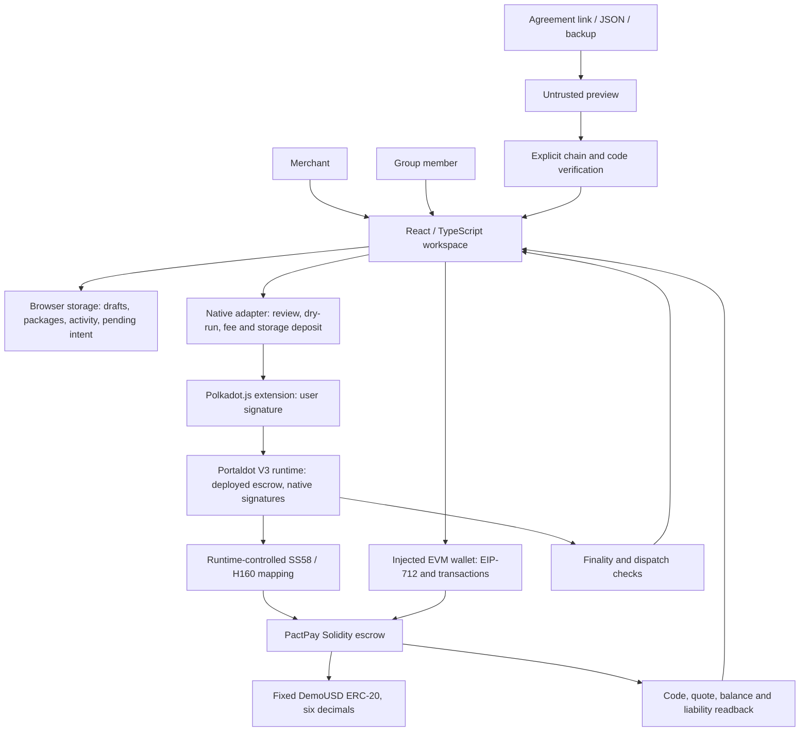
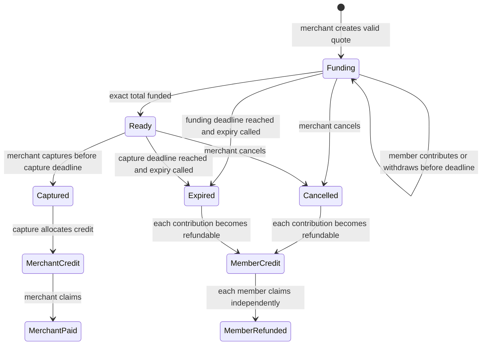

# PactPay architecture and authority

Implemented target design, reviewed against source on 29 October 2026. The public frontend exists. The V3 contract/runtime interaction below remains a deployment target; local EVM tests do not prove Revive execution.

The drawing describes two wallet paths to the same contract model. The current local native browser harness replaces extension/runtime transport with a simulated adapter and executes transactions against isolated Ganache. It does not execute the real runtime box. Test fixtures may reuse V3's chain ID; chain ID alone does not identify a public deployment.

## Contract lifecycle

Credit nodes explain accounting after a terminal collection state; they are not extra values of the Solidity `State` enum. Expiry is an explicit call, not a scheduled automatic transfer.

## Boundaries reviewers should inspect

| Boundary | Enforcement / source |
|---|---|
| Merchant authority | `contracts/PactPay.sol`: both creation routes require sender equals merchant; EVM route additionally verifies EIP-712 signature; native route relies on transaction authority |
| Immutable agreement | Chain/contract domain, unique merchant nonce, hashes of terms/member list/shares, fixed token and deadlines |
| Member authority | Listed caller contributes only their exact share; approval alone cannot contribute |
| Asset conservation | Deposits = pre-ready withdrawals + merchant payouts + member refunds + outstanding liability; direct donations can exceed liabilities |
| Native account identity | `src/native/adapter.ts`: runtime mapping and extension-controlled account, not a guessed SS58 substring |
| Untrusted import | `src/native/portability.ts`, `WorkspaceTransfer.tsx`: preview, validate deployment/quote on chain, then store; pending request blocks replacement |
| Transaction uncertainty | Persisted intent, finality/dispatch and readback; unresolved result blocks another send |
| Release isolation | `scripts/release.cjs`: production package excludes local deployment/quote fixtures |

No backend is required for the current MVP. Browser storage provides convenience and recovery context, not a trusted global order database. RPC availability and chain health affect operation; stale native state blocks signing. No product step guarantees merchant delivery. See [state machine](../state-machine.md) and [threat model](../threat-model.md).
